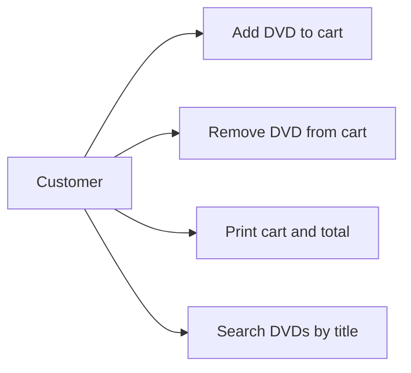

# AIMS-mini use cases

Actor: Customer (CLI user).

## Add DVD
Precondition: a DVD exists and cart has space. Success: append DVD and return True. Full cart: return False, preserve items. Limit: 20 DVDs.

## Search by title
Input: catalog and keyword. Return matching DVDs without changing the input. Intended behavior: substring matching, case-insensitive. The initial implementation will be audited against this requirement in Lab 05.
